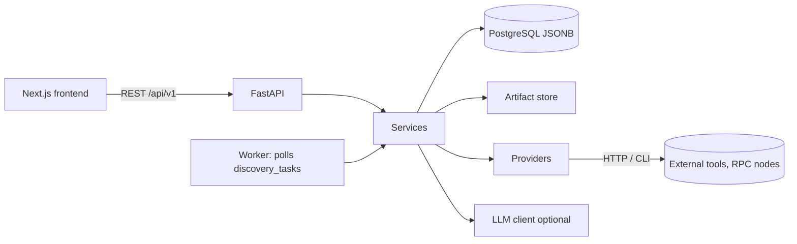

# Architecture

STATUS: IMPLEMENTED (single-process modular monolith; scaling pieces listed as PLANNED below)

## Shape

A modular monolith. One FastAPI application, one PostgreSQL database, one optional background worker process. No microservices, no Kubernetes, no graph database (ADR-0006, spec constraints).

## Layers

| Layer | Path | Rule |
|---|---|---|
| API | `backend/app/api/` | Thin. Validates input, enforces roles, calls services. Versioned under `/api/v1`. |
| Services | `backend/app/services/` | All business rules. The only code that writes knowledge. |
| Providers | `backend/app/providers/` | Adapters that return `NormalizedObservation`. They never write to the database. |
| Models | `backend/app/models.py` | 23 SQLAlchemy tables. Alembic migration `0001_initial_schema`. |
| LLM | `backend/app/llm/` | Optional. Output is validated and stored as claims only. |

## Key flows

- **Ingestion** is the single door into the knowledge base (`services/ingest.py`). See [DATA_FLOWS](DATA_FLOWS.md).
- **Discovery** creates tasks from references, applies source policy, executes or reuses provider runs, and spawns bounded follow-ups. See [DISCOVERY_ENGINE](DISCOVERY_ENGINE.md).
- **Graph** is computed on demand from `relationships` and observation provenance. No separate graph store. See [KNOWLEDGE_GRAPH](KNOWLEDGE_GRAPH.md).

## Runtime notes

- `init_runtime()` (`app/main.py`) creates tables only for SQLite. PostgreSQL uses Alembic (`alembic upgrade head`).
- The worker (`python -m app.worker`) loops on the `discovery_tasks` table. Redis is not used yet (ADR-0006, PLANNED).
- Sessions are committed before the response is sent (`db.SessionDep`, function-scoped dependency).
- Authentication is JWT bearer with roles viewer < analyst < admin.

## Decisions

See [decisions/README.md](decisions/README.md).
